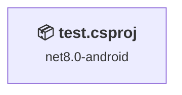
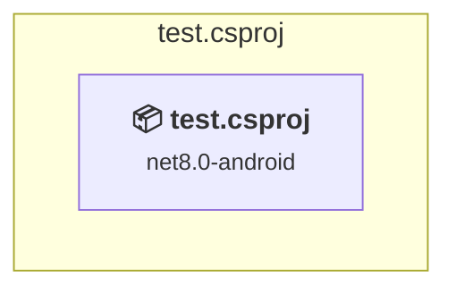

# Projects and dependencies analysis

This document provides a comprehensive overview of the projects and their dependencies in the context of upgrading to .NETCoreApp,Version=v10.0.

## Table of Contents

- [Executive Summary](#executive-Summary)
  - [Highlevel Metrics](#highlevel-metrics)
  - [Projects Compatibility](#projects-compatibility)
  - [Package Compatibility](#package-compatibility)
  - [API Compatibility](#api-compatibility)
- [Aggregate NuGet packages details](#aggregate-nuget-packages-details)
- [Top API Migration Challenges](#top-api-migration-challenges)
  - [Technologies and Features](#technologies-and-features)
  - [Most Frequent API Issues](#most-frequent-api-issues)
- [Projects Relationship Graph](#projects-relationship-graph)
- [Project Details](#project-details)

  - [test\test.csproj](#testtestcsproj)

## Executive Summary

### Highlevel Metrics

| Metric | Count | Status |
| :--- | :---: | :--- |
| Total Projects | 1 | All require upgrade |
| Total NuGet Packages | 2 | 1 need upgrade |
| Total Code Files | 16 |  |
| Total Code Files with Incidents | 10 |  |
| Total Lines of Code | 3389 |  |
| Total Number of Issues | 1235 |  |
| Estimated LOC to modify | 1234+ | at least 36,4% of codebase |

### Projects Compatibility

| Project | Target Framework | Difficulty | Package Issues | API Issues | Est. LOC Impact | Description |
| :--- | :---: | :---: | :---: | :---: | :---: | :--- |
| [test\test.csproj](#testtestcsproj) | net8.0-android | 🟢 Low | 1 | 1234 | 1234+ | DotNetCoreApp, Sdk Style = True |

### Package Compatibility

| Status | Count | Percentage |
| :--- | :---: | :---: |
| ✅ Compatible | 1 | 50,0% |
| ⚠️ Incompatible | 0 | 0,0% |
| 🔄 Upgrade Recommended | 1 | 50,0% |
| ***Total NuGet Packages*** | ***2*** | ***100%*** |

### API Compatibility

| Category | Count | Impact |
| :--- | :---: | :--- |
| 🔴 Binary Incompatible | 0 | High - Require code changes |
| 🟡 Source Incompatible | 1234 | Medium - Needs re-compilation and potential conflicting API error fixing |
| 🔵 Behavioral change | 0 | Low - Behavioral changes that may require testing at runtime |
| ✅ Compatible | 4232 |  |
| ***Total APIs Analyzed*** | ***5466*** |  |

## Aggregate NuGet packages details

| Package | Current Version | Suggested Version | Projects | Description |
| :--- | :---: | :---: | :--- | :--- |
| Microsoft.Extensions.Logging.Debug | 10.0.0 | 10.0.5 | [test.csproj](#testtestcsproj) | La mise à niveau du package NuGet est recommandée |
| Microsoft.Maui.Controls | 8.0.3 |  | [test.csproj](#testtestcsproj) | ✅Compatible |

## Top API Migration Challenges

### Technologies and Features

| Technology | Issues | Percentage | Migration Path |
| :--- | :---: | :---: | :--- |

### Most Frequent API Issues

| API | Count | Percentage | Category |
| :--- | :---: | :---: | :--- |
| T:Microsoft.Maui.Controls.Button | 91 | 7,4% | Source Incompatible |
| P:Microsoft.Maui.Controls.VisualElement.IsVisible | 53 | 4,3% | Source Incompatible |
| T:Microsoft.Maui.Controls.LayoutOptions | 48 | 3,9% | Source Incompatible |
| T:Microsoft.Maui.Controls.Image | 43 | 3,5% | Source Incompatible |
| T:Microsoft.Maui.Controls.GraphicsView | 39 | 3,2% | Source Incompatible |
| P:Microsoft.Maui.Controls.VisualElement.IsEnabled | 39 | 3,2% | Source Incompatible |
| T:Microsoft.Maui.GridLength | 34 | 2,8% | Source Incompatible |
| T:Microsoft.Maui.Controls.Label | 29 | 2,4% | Source Incompatible |
| T:Microsoft.Maui.Controls.NameScopeExtensions | 28 | 2,3% | Source Incompatible |
| M:Microsoft.Maui.Controls.NameScopeExtensions.FindByName''1(Microsoft.Maui.Controls.Element,System.String) | 28 | 2,3% | Source Incompatible |
| T:Microsoft.Maui.Thickness | 24 | 1,9% | Source Incompatible |
| P:Microsoft.Maui.Controls.VisualElement.Opacity | 23 | 1,9% | Source Incompatible |
| T:Microsoft.Maui.Controls.Grid | 20 | 1,6% | Source Incompatible |
| T:Microsoft.Maui.Controls.Shell | 17 | 1,4% | Source Incompatible |
| T:Microsoft.Maui.Controls.ImageSource | 17 | 1,4% | Source Incompatible |
| T:Microsoft.Maui.Controls.Picker | 17 | 1,4% | Source Incompatible |
| M:Microsoft.Maui.Controls.GraphicsView.Invalidate | 15 | 1,2% | Source Incompatible |
| T:Microsoft.Maui.GestureStatus | 15 | 1,2% | Source Incompatible |
| T:Microsoft.Maui.Controls.ListView | 15 | 1,2% | Source Incompatible |
| P:Microsoft.Maui.Controls.GraphicsView.Drawable | 14 | 1,1% | Source Incompatible |
| T:Microsoft.Maui.Controls.Application | 13 | 1,1% | Source Incompatible |
| T:Microsoft.Maui.Controls.Page | 12 | 1,0% | Source Incompatible |
| P:Microsoft.Maui.Controls.View.GestureRecognizers | 12 | 1,0% | Source Incompatible |
| T:Microsoft.Maui.Controls.SearchBar | 12 | 1,0% | Source Incompatible |
| P:Microsoft.Maui.Controls.VisualElement.BackgroundColor | 11 | 0,9% | Source Incompatible |
| P:Microsoft.Maui.Controls.Image.Source | 11 | 0,9% | Source Incompatible |
| P:Microsoft.Maui.Controls.Label.Text | 10 | 0,8% | Source Incompatible |
| F:Microsoft.Maui.GridLength.Auto | 10 | 0,8% | Source Incompatible |
| T:Microsoft.Maui.Controls.ColumnDefinition | 10 | 0,8% | Source Incompatible |
| M:Microsoft.Maui.Controls.ColumnDefinition.#ctor(Microsoft.Maui.GridLength) | 10 | 0,8% | Source Incompatible |
| M:Microsoft.Maui.Thickness.#ctor(System.Double,System.Double) | 10 | 0,8% | Source Incompatible |
| P:Microsoft.Maui.Controls.View.VerticalOptions | 10 | 0,8% | Source Incompatible |
| P:Microsoft.Maui.Controls.Shell.Current | 8 | 0,6% | Source Incompatible |
| E:Microsoft.Maui.Controls.TapGestureRecognizer.Tapped | 8 | 0,6% | Source Incompatible |
| P:Microsoft.Maui.Controls.TapGestureRecognizer.NumberOfTapsRequired | 8 | 0,6% | Source Incompatible |
| T:Microsoft.Maui.Controls.TapGestureRecognizer | 8 | 0,6% | Source Incompatible |
| M:Microsoft.Maui.Controls.TapGestureRecognizer.#ctor | 8 | 0,6% | Source Incompatible |
| M:Microsoft.Maui.Controls.Grid.SetRow(Microsoft.Maui.Controls.BindableObject,System.Int32) | 8 | 0,6% | Source Incompatible |
| T:Microsoft.Maui.Controls.RowDefinition | 8 | 0,6% | Source Incompatible |
| M:Microsoft.Maui.Controls.RowDefinition.#ctor(Microsoft.Maui.GridLength) | 8 | 0,6% | Source Incompatible |
| T:Microsoft.Maui.Controls.ColumnDefinitionCollection | 8 | 0,6% | Source Incompatible |
| F:Microsoft.Maui.Controls.LayoutOptions.Center | 8 | 0,6% | Source Incompatible |
| P:Microsoft.Maui.Controls.VisualElement.TranslationY | 7 | 0,6% | Source Incompatible |
| P:Microsoft.Maui.Controls.VisualElement.TranslationX | 7 | 0,6% | Source Incompatible |
| P:Microsoft.Maui.Controls.Picker.SelectedIndex | 7 | 0,6% | Source Incompatible |
| P:Microsoft.Maui.Controls.Shell.CurrentPage | 6 | 0,5% | Source Incompatible |
| P:Microsoft.Maui.Controls.Application.MainPage | 6 | 0,5% | Source Incompatible |
| P:Microsoft.Maui.Controls.Application.Current | 6 | 0,5% | Source Incompatible |
| P:Microsoft.Maui.Controls.Layout.Children | 6 | 0,5% | Source Incompatible |
| F:Microsoft.Maui.GridLength.Star | 6 | 0,5% | Source Incompatible |

## Projects Relationship Graph

Legend:
📦 SDK-style project
⚙️ Classic project

## Project Details

### test\test.csproj

#### Project Info

- **Current Target Framework:** net8.0-android✅
- **SDK-style**: True
- **Project Kind:** DotNetCoreApp
- **Dependencies**: 0
- **Dependants**: 0
- **Number of Files**: 16
- **Number of Files with Incidents**: 10
- **Lines of Code**: 3389
- **Estimated LOC to modify**: 1234+ (at least 36,4% of the project)

#### Dependency Graph

Legend:
📦 SDK-style project
⚙️ Classic project

### API Compatibility

| Category | Count | Impact |
| :--- | :---: | :--- |
| 🔴 Binary Incompatible | 0 | High - Require code changes |
| 🟡 Source Incompatible | 1234 | Medium - Needs re-compilation and potential conflicting API error fixing |
| 🔵 Behavioral change | 0 | Low - Behavioral changes that may require testing at runtime |
| ✅ Compatible | 4232 |  |
| ***Total APIs Analyzed*** | ***5466*** |  |

